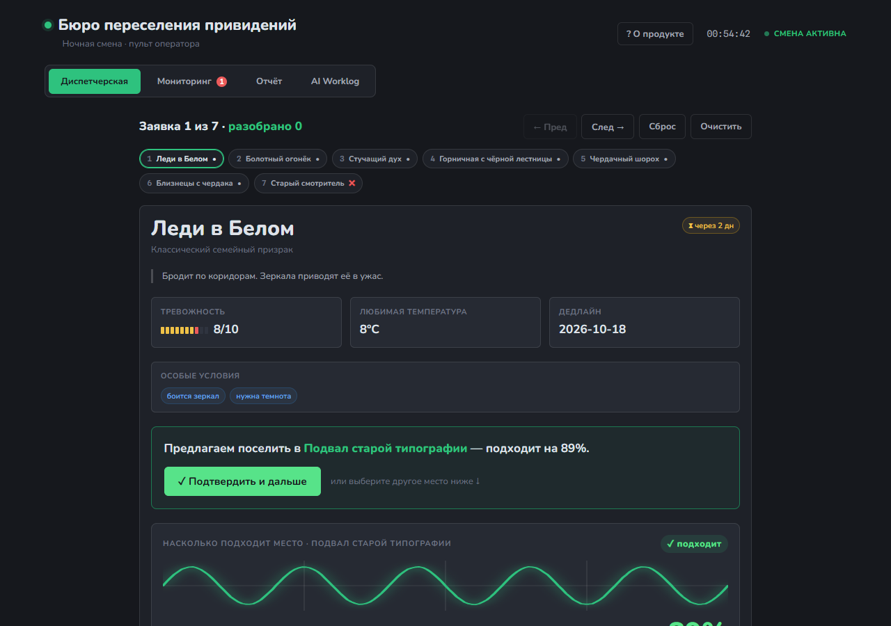

# 👻 Бюро переселения привидений · Ночная смена

Пульт оператора, который расселяет привидений из старых домов по новым местам
обитания: подбирает лучшее место под каждую заявку, объясняет каждое решение и
честно показывает, кого переселить невозможно и почему.

- **Рабочее приложение:** https://dmilitary.github.io/ghost-bureau/ ← _ссылка оживёт после первого деплоя (см. «Деплой»)_
- **Репозиторий:** https://github.com/Dmilitary/ghost-bureau

> Тема сказочная, но проверяет рабочие навыки: декомпозицию, состояние
> приложения, краевые случаи и завершённость. Приложение работает полностью на
> клиенте — без бэкенда, аккаунтов и секретов.



---

## Сценарий за одну минуту

1. На входе — **приветственный экран**: что это за продукт и какая цель (подобрать
   каждому привидению подходящее место). Жмёте «Начать смену».
2. **Диспетчерская** ведёт по заявкам **по одной**: привидение, его требования и
   предложенное место с обоснованием (осциллограф + процент совпадения). По
   каждой — **«Подтвердить и дальше»** или **«Выбрать»** другое место вручную.
3. Ручной выбор сразу проверяется: приложение предупредит, если место нарушает
   условие, переполнено или слабее автоматического.
4. Когда все заявки разобраны — кнопка ведёт на **Мониторинг**: табло со всем
   расселением, диаграмма заполняемости мест и список оставшихся без крыши.
5. Вкладка **Отчёт** сводит аналитику смены: сколько расселено, кто без места,
   какие места перегружены, самые проблемные заявки.
6. Вкладка **AI Worklog** — журнал разработки: инструменты, этапы, промпты,
   решения и честная статистика.

Интерфейс — «инженерный пульт»: графитовый фон в духе Linux-терминала, палитра
ANSI (зелёный — основной), закруглённая типографика. Описание цели можно
открыть снова кнопкой «? О продукте» в шапке.

---

## Быстрый старт

Нужен **Node.js 20+**.

```bash
npm install      # установить зависимости
npm run dev      # запустить дев-сервер
```

Vite поднимется на `http://localhost:5173/ghost-bureau/` (путь с
`/ghost-bureau/` — из-за базового пути для GitHub Pages, это нормально).

```bash
npm test         # юнит-тесты движка подбора (Vitest)
npm run build    # production-сборка в dist/
npm run preview  # посмотреть собранную версию
```

---

## Как работает подбор

Формула намеренно простая и объяснимая. Логика живёт в
[`src/domain/`](src/domain/) и не зависит от React — её целиком покрывают тесты.

**1. Жёсткие ограничения (гейты).** Особое условие заявки либо выполняется, либо
место отсекается полностью — с человекочитаемой причиной:

| Условие | Когда место не подходит |
|---|---|
| нужен чердак | у места нет чердака |
| боится зеркал | в месте есть зеркала |
| нельзя рядом с людьми | в месте живут люди |
| любит сырость | влажность < 5/10 — «слишком сухо» |
| нужна темнота | освещение > 4/10 — «слишком светло» |
| нужна тишина | шум > 4/10 — «слишком шумно» |

**2. Балл совместимости** считается только для прошедших гейты мест — три
фактора с фиксированными весами:

```
сигнал = 0.45 · температура + 0.35 · покой + 0.20 · темнота
```

- **температура** — чем ближе температура места к любимой, тем выше (падает на разбросе 12°);
- **покой** — чем тише, тем лучше, причём тревожные привидения страдают от шума сильнее;
- **темнота** — привидения в среднем предпочитают темноту.

**3. Назначение** — жадное, по срочности: сначала просроченные, затем ближний
дедлайн, затем тревожность. Каждому — лучшее совместимое место со свободной
вместимостью. Если такого нет, заявка остаётся без места с разбором причин
(нет совместимых мест / все подходящие заполнены).

**4. Ручной выбор** оператора приоритетнее автоматического и никогда не
блокируется — но проверяется: нарушение условия, переполнение или наличие более
сильного варианта показываются как предупреждения.

---

## Обязательные состояния — где увидеть

| Состояние | Как воспроизвести |
|---|---|
| Пустой список заявок | «Диспетчерская» → **Очистить** (Мониторинг и Отчёт тоже станут пустыми) |
| Заявка без подходящего места | дойти до **«Старый смотритель»** — ему не подходит ни одно место (красный блок «переселить невозможно») |
| Место переполнено | у любой заявки нажать **«Выбрать»** у **«Чердак ратуши»** (вместимость 1), затем то же для второй — Мониторинг/Отчёт пометят перегруз |
| Ручной выбор конфликтует с условием | **«Леди в Белом»** → **«Выбрать»** у **Замка Вересковых** (там зеркала) |
| Понятное сообщение об ошибке | внизу экрана **«Смоделировать сбой данных»** |

---

## Чеклист проверки (прогнал сам перед сдачей)

- [x] `npm test` — 23 юнит-теста движка зелёные.
- [x] `npm run build` — сборка проходит без ошибок типов.
- [x] Пустой список заявок: очередь и отчёт показывают дружелюбные пустые состояния, приложение не падает.
- [x] «Старый смотритель» остаётся без места, показан разбор причин по каждому месту.
- [x] Ручное назначение двух привидений в «Чердак ратуши» переполняет его; отчёт помечает место перегруженным.
- [x] Ручной выбор «Леди в Белом» → Замок даёт ошибку «Нарушено условие: есть зеркала».
- [x] Неоптимальный ручной выбор показывает предупреждение «Есть вариант сильнее…».
- [x] «Смоделировать сбой данных» показывает понятный экран ошибки и кнопку восстановления, а не белый экран.
- [x] Просроченная заявка («Горничная») помечена и поднята в проблемные в отчёте.
- [x] Вёрстка не ломается на ширине мобильного экрана; фокус с клавиатуры виден; `prefers-reduced-motion` отключает анимации.

Полный прогон сценариев автоматизирован в Playwright-скрипте проверки (см. историю разработки).

---

## Структура проекта

```
src/
  domain/          чистая логика, без React
    types.ts         модель данных (заявки, места, условия)
    conditions.ts    особые условия и пороги как жёсткие гейты
    matching.ts      оценка пар, скоринг, решатель, валидация выбора
    report.ts        сведение финального отчёта
    matching.test.ts юнит-тесты (Vitest)
  data/
    seed.ts          демо-данные под все обязательные состояния
    worklog.ts       содержимое AI Worklog
  state/
    useBureau.ts     состояние приложения и производный результат
  components/
    Welcome.tsx      приветственный экран (цель продукта)
    Dispatcher.tsx   пошаговый разбор заявок
    Monitoring.tsx   табло мониторинга + диаграмма заполняемости
    Report.tsx       финальный отчёт
    Worklog.tsx      AI Worklog
    SignalTrace.tsx  осциллограф совпадения заявки и места
    ErrorBoundary.tsx страхующий барьер ошибок
  App.tsx            каркас, вкладки, шапка
  index.css          дизайн-система «инженерный пульт»
```

---

## Стек

React 19 · TypeScript · Vite · Vitest. Без UI-библиотек и бэкенда — вся
логика, графики и стили написаны вручную. Внешние ресурсы — только шрифты
Nunito и Spline Sans Mono с Google Fonts.

---

## Деплой на GitHub Pages

1. Создать репозиторий **`ghost-bureau`** и запушить код в ветку `main`.
2. В репозитории: **Settings → Pages → Source = GitHub Actions**.
3. Workflow [`.github/workflows/deploy.yml`](.github/workflows/deploy.yml) на
   каждом пуше в `main` прогоняет тесты, собирает проект и публикует `dist/`.
4. Если имя репозитория отличается от `ghost-bureau`, поправьте `base` в
   [`vite.config.ts`](vite.config.ts) на `/<имя-репозитория>/`.

---

## AI Worklog

Живёт **внутри приложения** — вкладка «AI Worklog». Там: использованные
AI-инструменты, время разработки, честная заметка про токены, этапы
(человек × AI), ключевые промпты, самостоятельные решения, где AI ошибся, что
переписано вручную и что улучшил бы в реальном продукте.

## Секреты

Их нет: приложение не ходит в сеть за данными и не требует ключей. В коде нет
токенов, паролей и `.env`.
